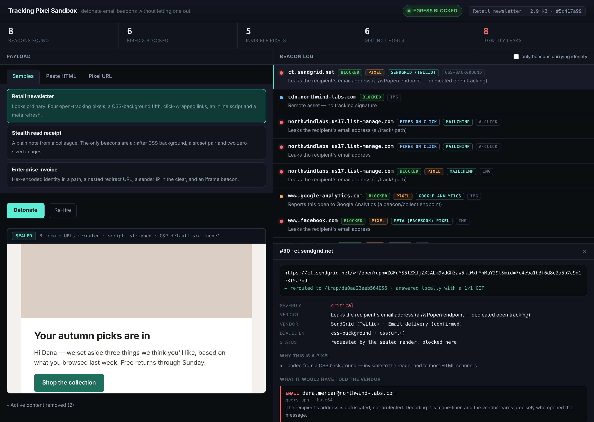
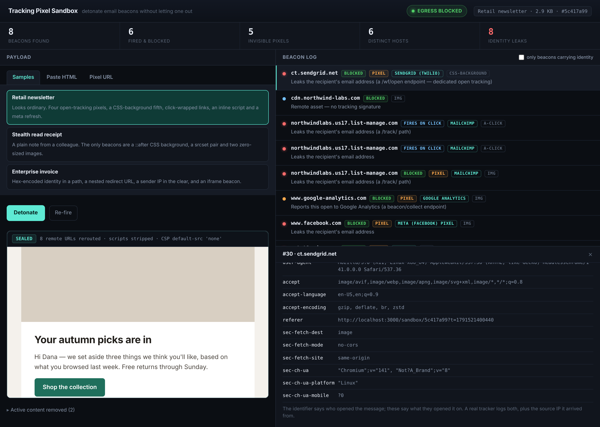
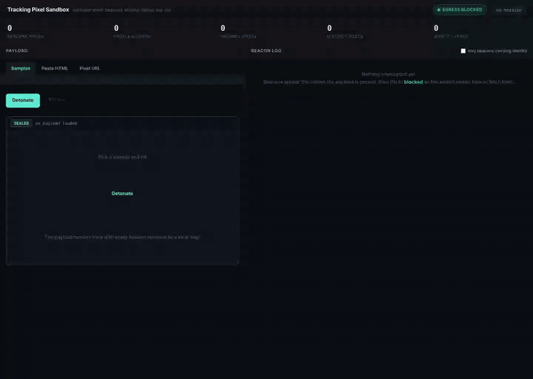

# Tracking Pixel Sandbox

A hermetic cloud environment for detonating email tracking pixels.

Paste a newsletter, a saved email body, or a single suspicious URL. The payload
renders in a sealed iframe where **no byte reaches the real internet**. Every
beacon it tries to fire is intercepted, decoded and attributed, so you can see
exactly what a tracking pixel would have told its vendor — and see it reduced to
a blocked, fully explained log entry.



## Run it

```bash
bun install && bun run dev      # http://localhost:3000
```

```bash
bun test                        # classifier unit tests
bun run probe                   # adversarial containment probe (see below)
bun run capture                 # drives a real browser, asserts containment, writes docs/
```

## The containment model

Four independent layers, so a miss in one is caught by the next:

| Layer | What it does |
| --- | --- |
| **Rewrite** | `HTMLRewriter` reroutes every remote URL — `src`, `srcset`, CSS `url()` in both `style` attributes and `<style>` blocks, `poster`, `background`, `iframe`, `link` — to a local `/trap/:id`. |
| **Strip** | `<script>`, `<base>`, `<meta http-equiv=refresh>`, `on*` handlers and active-scheme URLs are removed before render. |
| **Seal** | `/sandbox/:id` is served under `default-src 'none'; img-src 'self' data:; …`, so a URL shape the rewriter missed is refused by the browser rather than quietly fetched. |
| **Confine** | The preview iframe is `sandbox="allow-same-origin"` (no scripts, no forms, no top-level navigation) with `referrerpolicy="no-referrer"`. |

The collector answers with a local 1×1 GIF and **forwards nothing**. There is
deliberately no "replay this beacon for real" button: a sandbox that can phone
home is not a sandbox.

Both runnable checks assert this rather than asserting it in prose. They record
every request the browser makes while rendering a payload full of live tracker
hostnames, and fail if a single one resolves anywhere but `localhost`.

`bun run capture` does it for the real samples:

```
  requests made by the browser: 19
  distinct hosts contacted:    localhost:3000

  CONTAINMENT HELD — every request stayed on http://localhost:3000
```

`bun run probe` is the adversarial version: a payload built entirely of awkward
URL shapes — `@import` in both its forms, `image-set()`, `imagesrcset`, SVG
`image href`, `srcdoc`, `poster`, legacy `background` attributes, `object data`
— to check that the rewriter catches what a naive `src`/`href` pass would miss,
and that the CSP catches whatever the rewriter still misses.

```
rewriter intercepted 21 shapes
stripped outright: 3
CSP refusals (the backstop doing its job): 2

PROBE PASSED — not one of these shapes reached the network.
```

This is not a hypothetical: the probe is what caught
`<link rel=preload imagesrcset>` slipping past the rewriter into the CSP's
hands, which is how it came to be handled properly.

## What it tells you about each beacon

- **Who it reports to** — host and path signatures for ~30 senders and
  open-tracking vendors (Mailchimp, SendGrid, HubSpot, Klaviyo, Braze,
  Customer.io, Marketo, Salesforce, Postmark, Mandrill, Litmus, Streak, Mixmax,
  Yesware, Mailtrack, Superhuman, Google Analytics, Meta, DoubleClick, …).
- **Why it is a pixel** — collapsed dimensions, `display:none`, `opacity:0`,
  empty `alt`, or loaded from a CSS background where no `` tag exists for a
  scanner to find.
- **What it would have leaked** — path segments and query values are recursively
  URL-, base64-, hex- and delimiter-decoded, then scanned for addresses, MD5/SHA-1
  identity hashes, UUIDs, JWTs, embedded redirect URLs and IPs. A parameter the
  payload wrote as `upn=ZGFuYS5tZXJjZXJA…` is shown as the address it decodes to.
- **What the request itself carried** — the `User-Agent`, `Accept-Language` and
  client hints the blocked request actually sent. The identifier says *who* opened
  the message; these say *what they opened it on*.



## The run



Full-resolution video: [`docs/demo.mp4`](docs/demo.mp4).

## Samples

| Sample | What it demonstrates |
| --- | --- |
| **Retail newsletter** | Four open-tracking pixels, a fifth hidden in a CSS background, click-wrapped links, an inline script and a `meta refresh`. |
| **Stealth read receipt** | A plain note whose only beacons are a `::after` CSS background, a `srcset` pair and two zero-sized images. |
| **Enterprise invoice** | Hex identity in a valueless query key, a nested redirect URL, a sender IP in the clear, and an `iframe` beacon. |

The samples are synthetic. The hostnames are real vendors so attribution is
demonstrable, but the account ids are invented and the recipient is fictional.

## Limits

Worth being clear about what this is not:

- **Email-grade tracking only.** Scripts are stripped, not emulated, so this does
  not analyze browser-grade JS fingerprinting.
- **Static analysis of one hop.** Redirect chains are decoded where they are
  embedded in a URL, but nothing is followed — following would mean egress.
- **Heuristics, not ground truth.** A 32-hex value is *probably* an MD5 of the
  recipient; the tool says so and shows its reasoning rather than asserting it.
  Vendor attribution is by host and path signature, so a self-hosted tracker on a
  neutral domain is reported as an unattributed beacon, correctly.
- **One in-memory session.** No auth, no database, no persistence across restarts.

## Layout

```
src/server.ts        Bun.serve — UI, /api/analyze, /sandbox/:id, /trap/*, SSE
src/rewrite.ts       HTMLRewriter passes: reroute remote URLs, strip active content
src/classify.ts      vendor table, pixel heuristics, recursive leak decoder, severity
src/store.ts         in-memory session + beacon log, SSE fan-out
src/samples.ts       the three built-in payloads
src/classify.test.ts unit tests for the vendor table and the decoders
public/              single-page UI (no framework, no runtime dependencies)
scripts/capture.mjs       Playwright run: containment assertion + proof artifacts
scripts/evasion-probe.mjs adversarial containment probe
```

No runtime dependencies. `playwright` is a devDependency used only by `bun run capture`.
